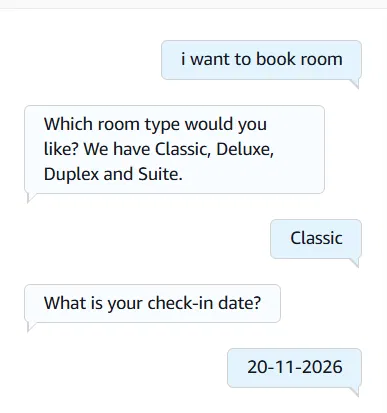

# Hotel Booking Chatbot using Amazon Lex

A conversational chatbot that books hotel rooms, built with Amazon Lex V2 and AWS Lambda.

## Features
- Shows available room types and prices
- Collects room type, check-in date, nights, guests and guest name
- Asks for confirmation before booking
- Returns booking ID, stay duration, price per night and total price

## Room types
| Room | Price per night |
|---|---|
| Classic | Rs.2,500 |
| Deluxe | Rs.3,500 |
| Duplex | Rs.5,000 |
| Suite | Rs.8,000 |

## Architecture
User -> Amazon Lex (intents and slots) -> AWS Lambda (price calculation) -> Confirmation message

## Intents
- `BookHotel`: main booking flow with 5 slots and confirmation
- `RoomInfo`: lists available rooms and prices

## How it works
1. User says "Book a room"
2. Lex asks for each slot in order
3. User confirms
4. Lambda calculates the total and returns the booking summary

## Screenshots

## Tech stack
Amazon Lex V2, AWS Lambda (Python 3.12)

## Author
Darshan Gowda B - www.linkedin.com/in/darshan-gowda-b-darshan
